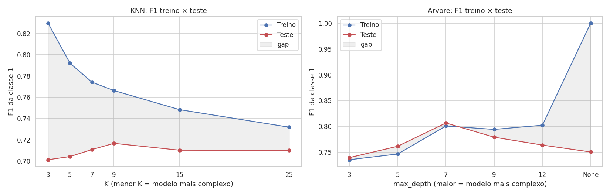
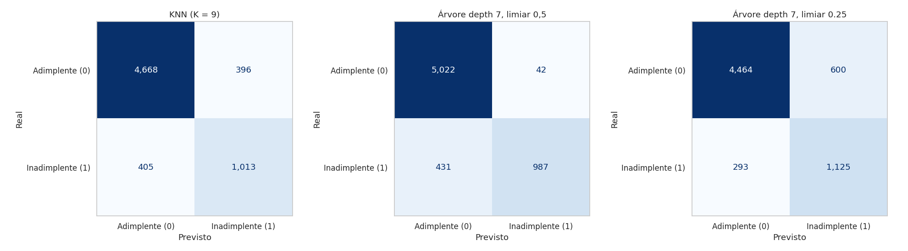

# Risco de Crédito: prevendo inadimplência com KNN e Árvore de Decisão

Este é o meu projeto avaliativo do Módulo 1 do curso de Machine Learning e Visão Computacional (T3). Escolhi a
Opção A, a base de risco de crédito, e construí o pipeline inteiro: análise exploratória, limpeza, criação de
variável, preparação dos dados, comparação entre KNN e Árvore de Decisão e, no fim, uma recomendação para o banco.

Todo o código está em [`risco_credito.ipynb`](risco_credito.ipynb), dividido nas seis fases do enunciado.

## O problema

Um banco precisa decidir se aprova ou não um pedido de empréstimo. O modelo tenta prever se o cliente vai ficar
inadimplente (`loan_status = 1`) ou pagar em dia (`loan_status = 0`).

O modelo pode errar de dois jeitos, e eles não custam a mesma coisa:

- **Falso positivo:** o modelo marca como arriscado um cliente que pagaria em dia. O banco recusa o empréstimo e
  deixa de ganhar os juros. No conjunto de teste, isso dá em média uns $1 mil por contrato.
- **Falso negativo:** o modelo marca como seguro um cliente que não vai pagar. O banco empresta e perde o valor
  emprestado, em média uns $11 mil por contrato.

Ou seja, aprovar um inadimplente custa cerca de 11 vezes mais do que recusar um bom pagador. Por isso escolhi o
modelo olhando o custo total dos erros em dinheiro, e não a acurácia.

## Resumo para a diretoria

Minha recomendação é colocar em produção a **Árvore de Decisão com `max_depth = 7` e limiar de decisão de 0,25**.

Nos 6.482 clientes do conjunto de teste, que o modelo nunca tinha visto:

- ela identifica 79% dos inadimplentes;
- se o banco aprovasse todo mundo, a perda com inadimplência seria de $15,5 milhões. Com o modelo, o custo total
  dos erros cai para $3,3 milhões, uma economia de cerca de $12,2 milhões;
- esse custo fica uns 16% abaixo do melhor KNN, mesmo supondo que o banco perde 100% do valor em cada
  inadimplência;
- o desempenho no treino e no teste é praticamente o mesmo (F1 de 0,80 e 0,81), então não há sinal de overfitting.

Outro motivo para preferir a árvore é que dá para explicar a decisão. A primeira pergunta que ela faz é se o grau
do empréstimo é A, B ou C. A segunda é se o empréstimo compromete mais de uns 30% da renda do cliente. Um analista
de crédito entende essas regras e consegue justificar uma recusa. Com o KNN isso não é possível.

### O que a análise exploratória mostrou

1. A base é desbalanceada: 78% dos clientes pagam em dia e 22% ficam inadimplentes. Um modelo que aprovasse todo
   mundo teria 78% de acurácia sem servir para nada, então trabalhei com recall, precisão e F1 da classe
   inadimplente.
2. Havia erros de registro, como idades de 123 e 144 anos e 123 anos de emprego. Removi essas 7 linhas.
3. O que mais se relaciona com a inadimplência é o peso do empréstimo na renda. A coluna que criei,
   `comprometimento_renda`, tem a maior correlação com o alvo (0,39) e acabou sendo a variável mais importante da
   árvore (34%).
4. O grau do empréstimo funciona como uma escada de risco: cerca de 10% de inadimplência no grau A e 98% no G.
5. A situação de moradia pesa bastante: quem aluga tem cerca de 32% de inadimplência, contra 7% de quem tem casa
   própria.
6. A renda tem uma cauda muito longa (mediana de $55 mil e máximo de $6 milhões). Isso atrapalha o KNN e pediu um
   tratamento específico para ele.

## Dicionário de dados

A base original (`data/credit_risk_dataset.csv`) tem 32.581 linhas e 12 colunas. Depois da limpeza ficaram 32.409
linhas, sem nulos.

| Coluna | Tipo | O que é | O que fiz com ela |
|---|---|---|---|
| `person_age` | inteiro | Idade do cliente, em anos | Removi idades acima de 100 (erro de registro) |
| `person_income` | inteiro | Renda anual | Mantive. Clipping entre os percentis 1 e 99 só para o KNN |
| `person_home_ownership` | categórica | Moradia: RENT, OWN, MORTGAGE ou OTHER | One-Hot Encoding |
| `person_emp_length` | decimal | Tempo de emprego, em anos | Removi valores acima de 60. Os 895 nulos receberam a mediana |
| `loan_intent` | categórica | Finalidade do empréstimo (educação, saúde, negócio, pessoal, consolidação de dívidas, reforma) | One-Hot Encoding |
| `loan_grade` | categórica ordinal | Grau de risco do empréstimo, de A (melhor) a G (pior) | Codificação ordinal (A=0 até G=6) |
| `loan_amnt` | inteiro | Valor do empréstimo | Mantive |
| `loan_int_rate` | decimal | Taxa de juros anual, em % | Os 3.116 nulos receberam a média |
| `loan_status` | inteiro | Alvo: 1 = inadimplente, 0 = pagou em dia | |
| `loan_percent_income` | decimal | Empréstimo dividido pela renda, arredondado em 2 casas | Removi, porque é quase idêntica à coluna nova (correlação de 0,999) |
| `cb_person_default_on_file` | categórica | Se o cliente já teve inadimplência registrada (Y/N) | Virou binária (Y=1, N=0) |
| `cb_person_cred_hist_length` | inteiro | Tempo de histórico de crédito, em anos | Mantive |
| `comprometimento_renda` (nova) | decimal | Coluna calculada: `(loan_amnt / person_income) * 100`. É o percentual da renda anual que o empréstimo compromete | Criada na Fase 3, depois de conferir que não havia nulos nem renda zero nas colunas de origem |

## Como cheguei ao resultado

**Limpeza.** Removi 165 linhas duplicadas e as 7 com valores impossíveis. Para os nulos, olhei a forma de cada
distribuição. A taxa de juros é quase simétrica (assimetria de 0,21, com média e mediana praticamente iguais),
então usei a média. O tempo de emprego é assimétrico à direita (1,25), e nesse caso a média é puxada pela cauda,
então usei a mediana.

**Outliers.** Os valores altos que sobraram são clientes reais, e apagar esses registros faria o modelo não saber
avaliar justamente os contratos maiores. Mantive todos na base e tratei de forma diferente em cada modelo. A árvore
recebe os dados como estão, porque ela só faz cortes do tipo "renda menor que X" e um valor extremo não muda esses
cortes. O KNN mede distância entre clientes, e um valor extremo distorce essa distância. Só para ele apliquei
clipping entre os percentis 1 e 99, com os limites calculados no treino.

**Variável nova.** Criei `comprometimento_renda` e removi `loan_percent_income`, que trazia a mesma informação.
Com as duas, o KNN contaria esse fator em dobro.

**Preparação.** Separei 80% para treino e 20% para teste com `stratify=y`. O balanceamento (SMOTENC) foi aplicado
só no treino, e o teste ficou com a proporção real de 78/22. O `StandardScaler` foi usado só nas variáveis
contínuas e só para o KNN. No notebook há uma célula mostrando que a árvore faz exatamente as mesmas previsões com
ou sem escalonamento.

**Ajuste de limiar.** Como o falso negativo é bem mais caro, testei limiares de decisão diferentes de 0,5 para a
árvore. A escolha do 0,25 foi feita por validação cruzada dentro do treino, com o SMOTE aplicado em cada fold, sem
usar o teste.

## Overfitting

Testei seis valores de K e seis profundidades, sempre comparando o F1 da classe inadimplente no treino e no teste.



| Modelo | Configuração | F1 treino | F1 teste | Diferença | Leitura |
|---|---|---|---|---|---|
| Árvore | `max_depth=None` | 1,000 | 0,751 | 0,249 | Decorou o treino (2.501 folhas) |
| Árvore | `max_depth=12` | 0,802 | 0,764 | 0,039 | Já começa a decorar |
| Árvore | `max_depth=7` (escolhida) | 0,801 | 0,807 | -0,006 | Melhor teste, sem diferença para o treino |
| Árvore | `max_depth=3` | 0,735 | 0,740 | -0,004 | Simples demais |
| KNN | `K=3` | 0,830 | 0,701 | 0,129 | Poucos vizinhos, memoriza ruído |
| KNN | `K=9` (escolhido) | 0,766 | 0,717 | 0,050 | Melhor teste |
| KNN | `K=25` | 0,732 | 0,710 | 0,022 | Diferença menor, mas o teste não melhora |

Um detalhe: medi o treino na base original, sem os clientes sintéticos do SMOTE. Assim treino e teste têm a mesma
proporção de classes e a comparação fica justa.

## Resultado no teste



| Modelo | Inadimplentes aprovados (FN) | Bons pagadores recusados (FP) | Precisão | Recall | Custo total dos erros |
|---|---|---|---|---|---|
| KNN (K=9) | 405 | 396 | 0,72 | 0,71 | $3,99 mi |
| Árvore (profundidade 7, limiar 0,5) | 431 | 42 | 0,96 | 0,70 | $4,20 mi |
| Árvore (profundidade 7, limiar 0,25) | 293 | 600 | 0,65 | 0,79 | $3,35 mi |

O custo soma o valor emprestado aos inadimplentes aprovados (supondo perda de 100%) com um ano de juros dos bons
pagadores recusados.

Vale registrar que o resultado não é óbvio. No limiar padrão de 0,5 e com perda de 100%, o KNN sai um pouco mais
barato que a árvore, porque deixa passar menos inadimplentes. A árvore passa a ser a mais barata quando o banco
perde menos de 74% do valor em cada inadimplência, o que é o cenário normal, já que parte do dinheiro costuma ser
recuperada. E com o limiar ajustado para 0,25 ela tem o menor custo dos três também no cenário de perda de 100%.

## Como rodar

```bash
git clone <url-deste-repositorio>
cd projeto-risco-credito
pip install -r requirements.txt
jupyter notebook risco_credito.ipynb
```

O notebook roda do início ao fim em menos de um minuto e salva os gráficos em `reports/figures/`.

## Estrutura

```
├── data/
│   └── credit_risk_dataset.csv     base original (Opção A)
├── reports/figures/                gráficos gerados pelo notebook
├── risco_credito.ipynb             notebook com as seis fases
├── requirements.txt
└── README.md
```

Feito com Python, pandas, NumPy, Matplotlib, Seaborn, scikit-learn e imbalanced-learn.
